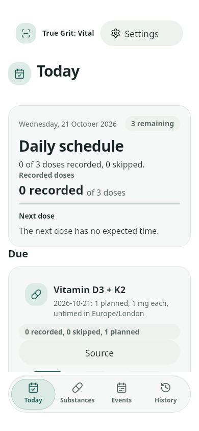
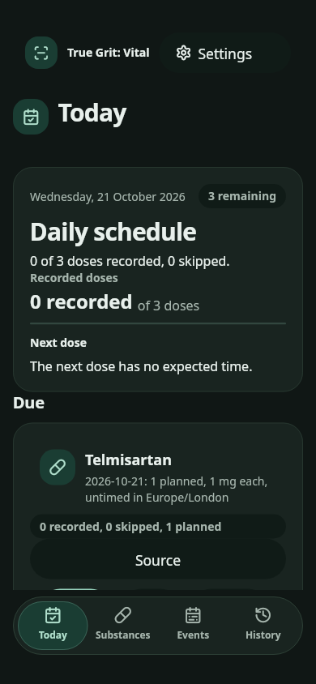
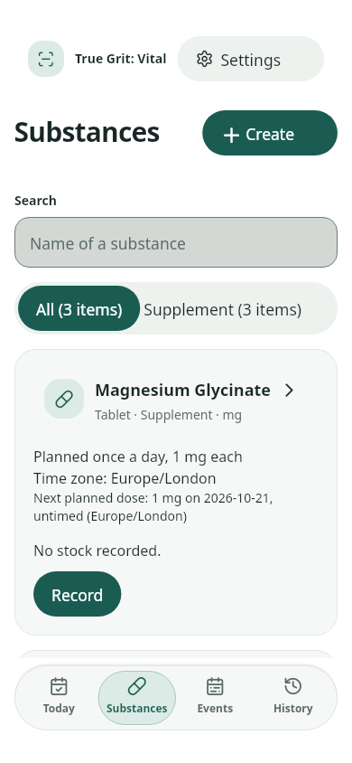
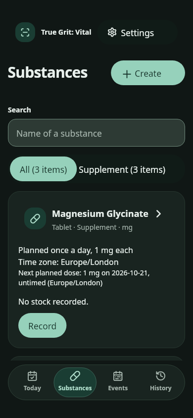
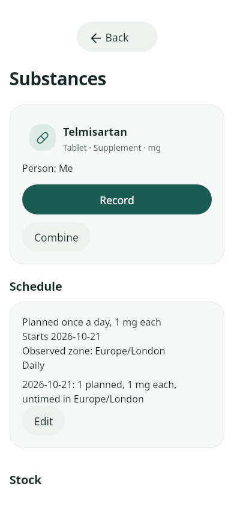
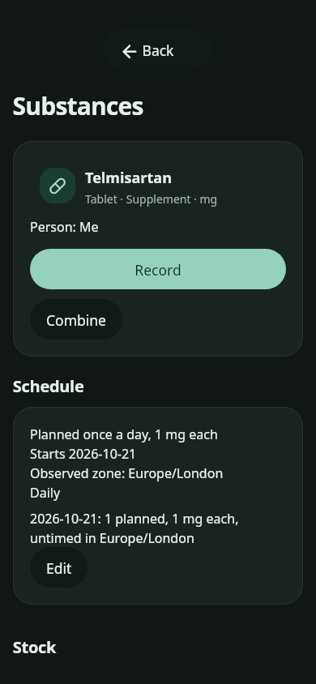

# First design batch

Host-rendered screenshots from the integrated D01–D05 work, 21 October 2026.
These use synthetic test records and the real app fonts at 390 × 844, with
28 px top and 24 px bottom device safe areas. Quantities demonstrate layout.
The [original Stitch references](../../stitch/2026-10-20/README.md) remain the
source design archive; these images record the current Flutter implementation.

| Screen | Light | Dark |
| --- | --- | --- |
| Today |  |  |
| Substances |  |  |
| Substance overview |  |  |

Regenerate with `test/visual_framework_test.dart`, setting `VITAL_UI_ROUTES` to
`today,substances,substance-overview` and `VITAL_UI_SNAPSHOTS` to an output directory.
The harness waits for loaded records before capture. These are widget-rendered
host checks; physical-device accessibility and performance gates remain open.
