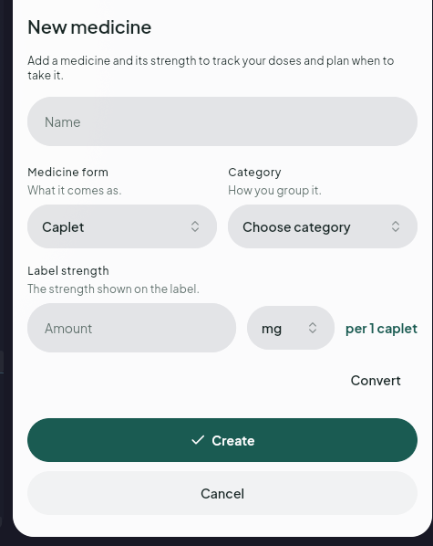

# Approved form reference

Owner-approved New medicine hierarchy, 23 October 2026. Apply the [form standard](../../interaction-blueprint.md#form-standard) to new and revised sheet and full-page forms, using the [shared components](../../components.md).

The source screenshot is preserved unchanged. The owner's subsequent correction removes the decorative tick from Create. Sheet actions remain stacked and full width. Full-page forms use equal-width Cancel and primary-action columns, with accessible stacking when full labels cannot fit. Preserve existing save, draft, privacy and dismissal guards.
